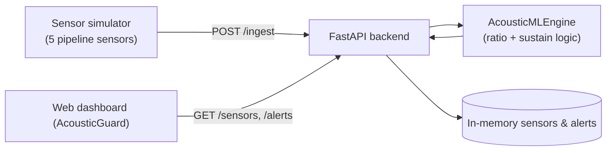

# Acoustic Leak Detector

> Detect gas/water micro-leaks from pipeline acoustics — a small full-stack demo with a live monitoring dashboard.


## Idea

A pressurized pipe leaking gas emits a high-frequency **hiss** on top of the low-frequency **rumble** of normal background noise. This demo classifies those acoustic signatures in real time and raises an alert when a sustained hiss appears at a sensor.

It ships with a **sensor simulator** (five sensors along a pipeline) so you can watch the whole pipeline — ingest → detection → dashboard — without hardware.

## How detection works

The "ML engine" (`backend/ml_engine.py`) is a deliberately transparent, explainable classifier:

1. For each frame, compute the ratio `high_freq_power / low_freq_power`.
2. If the ratio exceeds a threshold (default `2.0`), it's a candidate hiss → increment that sensor's consecutive-frame counter.
3. Require the hiss to **sustain** for N consecutive frames (default `3`) before flagging an anomaly — this suppresses one-off noise spikes.
4. On a sustained hit, emit a `CRITICAL` alert ("Probable micro-leak").

Because it's rule-based and stateful per sensor, it's trivial to reason about and test — see `backend/test_app.py`.

## Architecture



## API

| Method | Route | Description |
|--------|-------|-------------|
| `POST` | `/ingest` | Submit sensor frame (`sensor_id`, `low_freq_power`, `high_freq_power`, `timestamp`) |
| `GET`  | `/sensors` | Current state of every known sensor |
| `GET`  | `/alerts` | Last 20 alerts |

## Project structure

```
acoustic-leak-detector/
├── backend/
│   ├── main.py            # FastAPI app + endpoints
│   ├── ml_engine.py       # Rule-based acoustic classifier
│   ├── simulator.py       # 5-sensor pipeline simulator
│   ├── test_app.py        # API + engine tests (pytest)
│   └── test_simulator.py
├── frontend/
│   ├── index.html         # "AcousticGuard" dashboard
│   ├── app.js             # Live polling + rendering
│   └── styles.css         # Glassmorphism UI
├── pyrightconfig.json
├── start.bat              # One-click launcher (Windows)
└── requirements.txt
```

## Setup

```bash
pip install -r requirements.txt
```

### Run it (Windows one-click)

```bat
start.bat
```

### Or manually

```bash
# terminal 1 — backend on :8000
cd backend && python main.py

# terminal 2 — feed it fake sensor data
cd backend && python simulator.py

# terminal 3 — dashboard on :8080
cd frontend && python -m http.server 8080
```

Open <http://localhost:8080> and watch sensors flip to `leak_detected` when a simulated leak starts.

## Tests

```bash
cd backend && pytest
```

## License

[MIT](LICENSE) © 2026 Omar Hindawy
